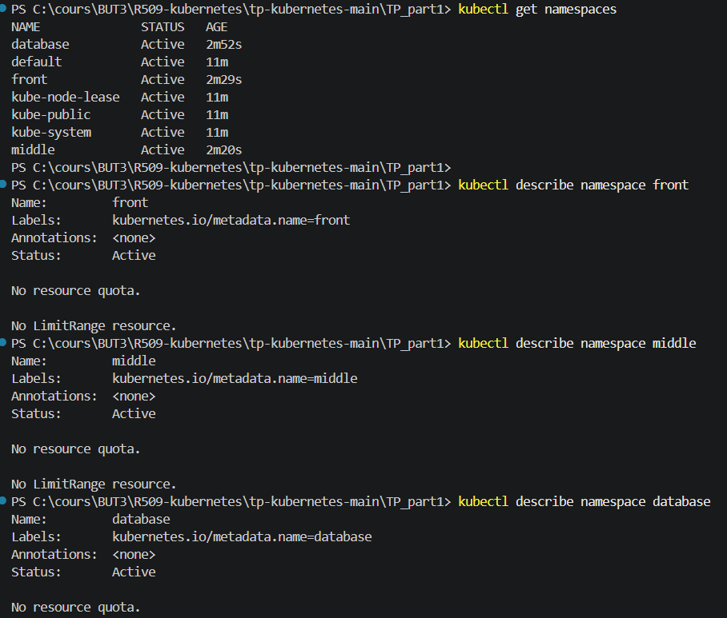
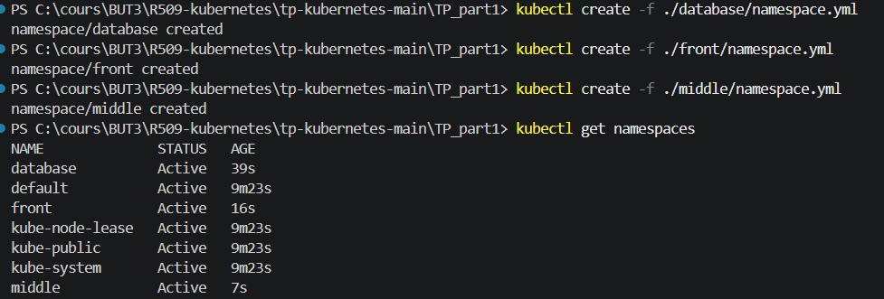
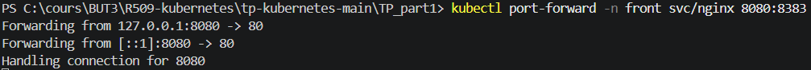

# Réponses - Partie 1

## Vérification des événements et des Pods

### Question 4

Pour vérifier les événements du namespace `front` :

```powershell
kubectl get events -n front
```

Pour vérifier le démarrage des Pods :

```powershell
kubectl get pods -n front
```

## Architecture Kubernetes

### Question 7

Les pointillés violets correspondent à un **worker node**. Il s'agit du nœud qui exécute les Pods et les conteneurs de l'application.

### Question 8

Les pointillés correspondent au **cluster Kubernetes**, qui regroupe le control plane et les worker nodes.

## Captures d'écran

### Capture 1



### Capture 2



### Capture 3


