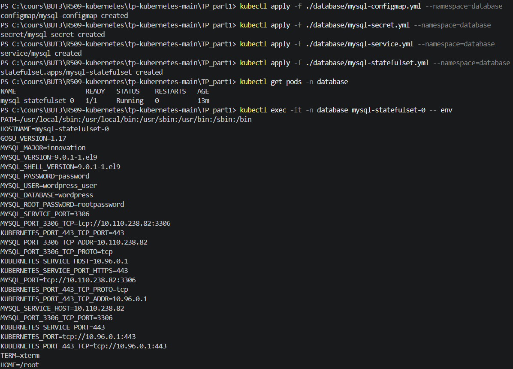
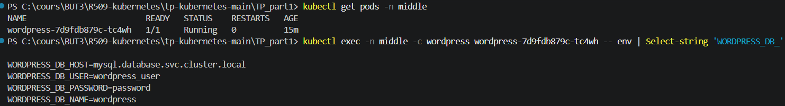
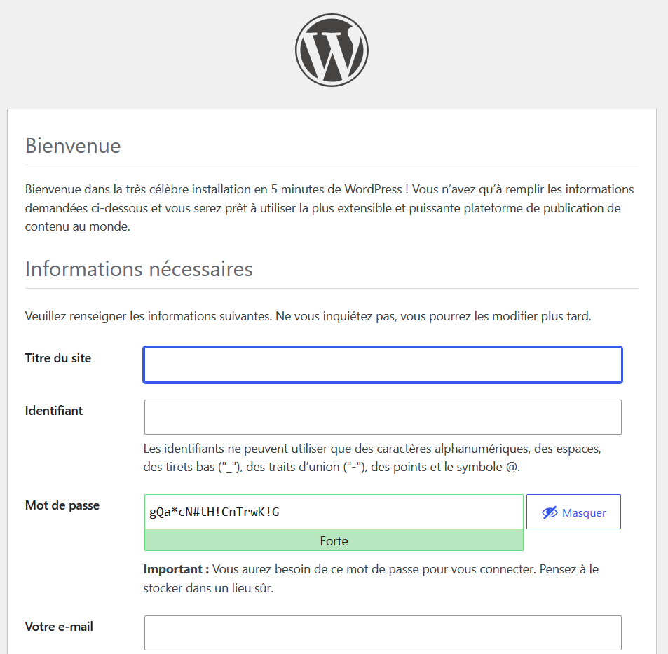

# Réponses - Partie 2

❓ Les différentes ressources sont déployées dans le bon namespace ? Quelle commande utilisez-vous pour vérifier cela ?

Oui. Chaque ressource est créée dans le namespace prévu : MySQL dans `database`, WordPress dans `middle` et Nginx dans `front`.

```powershell
kubectl get all -n database
kubectl get all -n middle
kubectl get all -n front
kubectl get configmap,secret -A
```

L'option `-A` affiche les ressources de tous les namespaces.

❓ Les ressources MySQL ConfigMap et MySQL sont à déployer au sein des namespaces middle et database, pourquoi ?

MySQL est déployé dans le namespace `database` afin d'isoler le service de base de données. WordPress est déployé dans `middle`, car il appartient à la couche applicative.

Un Pod ne peut pas référencer directement un Secret ou une ConfigMap situé dans un autre namespace. Les ressources `mysql-secret` et `mysql-configmap` utilisées par WordPress doivent donc aussi être présentes dans `middle`. WordPress peut en revanche accéder au Service MySQL grâce à son nom DNS :

```text
mysql.database.svc.cluster.local
```

❓ Les différentes pods sont-ils correctement démarrés ? Quelle commande utilisez-vous pour vérifier cela ?

Oui, les Pods sont correctement démarrés lorsqu'ils apparaissent avec un statut `Running` et que la colonne `READY` indique le nombre attendu de conteneurs, par exemple `1/1`.

```powershell
kubectl get pods -n database
kubectl get pods -n middle
kubectl get pods -n front
kubectl get pods -A
```

❓ Lorsqu'un pod est en erreur comment accédez-vous aux events du namespace et aux logs du pod ? Quelles commandes utilisez-vous pour vérifier cela ?

Pour consulter les événements du namespace :

```powershell
kubectl get events -n middle --sort-by=.lastTimestamp
```

Pour obtenir davantage de détails sur un Pod :

```powershell
kubectl describe pod <nom-du-pod> -n middle
```

Pour consulter ses logs :

```powershell
kubectl logs <nom-du-pod> -n middle
```

Si le Pod contient plusieurs conteneurs, il faut préciser le conteneur :

```powershell
kubectl logs <nom-du-pod> -c <nom-du-conteneur> -n middle
```

Exemple :

```powershell
kubectl logs deployment/wordpress -n middle
```

## Captures d'écran

### Déploiement de MySQL



### Déploiement de WordPress



### Déploiement de Nginx

