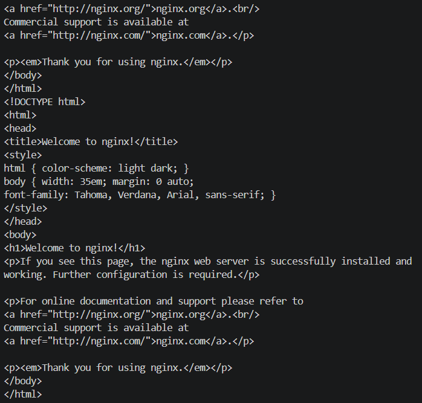

# Réponses - Partie 3

## CronJob

### Création du CronJob

Le fichier `cronjob.yml` contient un CronJob nommé `date`. Il est configuré pour
s'exécuter toutes les cinq minutes et exécuter la commande `date`.

```powershell
kubectl apply -f cronjob.yml
kubectl get cronjobs
kubectl get jobs
```

## HPA

### Question 4

Le résultat souhaité est que le Deployment démarre avec 2 pods. Le HPA surveille
l'utilisation moyenne du CPU et vise 50 % de la CPU demandée. Comme chaque pod
demande `250m` de CPU, le seuil est atteint à environ `125m`.

Lorsque la charge augmente et que l'utilisation dépasse ce seuil, Kubernetes
crée automatiquement des pods supplémentaires, jusqu'à 5 pods maximum. Lorsque
la charge diminue, le nombre de pods redescend progressivement jusqu'à 2.

### Question 6

Pour vérifier le HPA, la commande utilisée est :

```powershell
kubectl get hpa
```

Pour suivre son évolution en temps réel :

```powershell
kubectl get hpa -w
```

### Question 7

La commande `kubectl get hpa` affiche généralement les colonnes suivantes :

- **NAME** : nom du HorizontalPodAutoscaler.
- **REFERENCE** : Deployment contrôlé par le HPA.
- **TARGETS** : utilisation actuelle par rapport à la valeur cible, par exemple
  `80%/50%`.
- **MINPODS** : nombre minimal de pods autorisés.
- **MAXPODS** : nombre maximal de pods autorisés.
- **REPLICAS** : nombre actuel de pods gérés par le Deployment.
- **AGE** : durée écoulée depuis la création du HPA.

### Question 8

Pour créer le pod qui génère la charge :

```powershell
kubectl run -i --tty simulation-utilisateur --image=busybox:1.36 -- /bin/sh
```

Si le pod existe déjà, il faut entrer dans celui-ci avec :

```powershell
kubectl exec -it simulation-utilisateur -- /bin/sh
```

Depuis le pod, la boucle envoie continuellement des requêtes au Service :

```sh
while true; do wget -q -O- http://mon-application.default.svc.cluster.local; done
```

La réponse HTML de Nginx confirme que les requêtes atteignent correctement
l'application.



### Question 9

Le test de charge fonctionne si la page Nginx s'affiche et si la colonne
`TARGETS` du HPA contient une valeur, par exemple `80%/50%`. Le nombre de
réplicas doit alors augmenter au-dessus de 2, sans dépasser 5 :

```powershell
kubectl get hpa -w
kubectl get pods -w
```

Si `TARGETS` affiche `cpu: <unknown>/50%`, le HPA ne peut pas mesurer le CPU.
Il faut activer Metrics Server avec Minikube, puis attendre quelques secondes :

```powershell
minikube addons enable metrics-server
kubectl top pods
kubectl get hpa
```

Une fois les métriques disponibles, la charge peut déclencher la création de
pods supplémentaires. Lorsque la boucle est arrêtée avec `Ctrl+C`, le nombre de
pods redescend progressivement vers le minimum configuré, soit 2.
