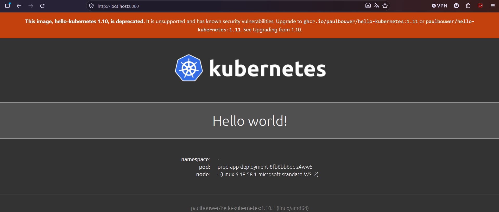
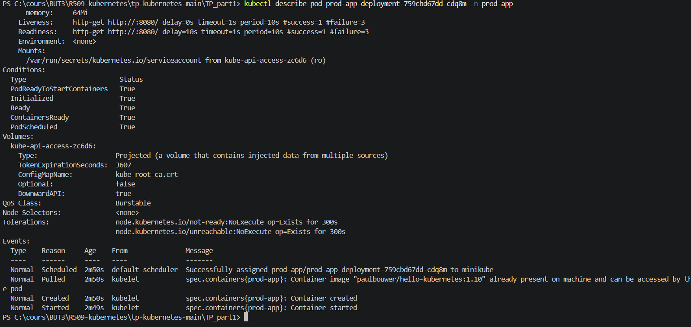
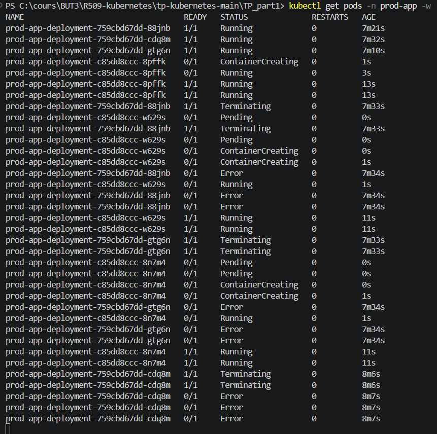
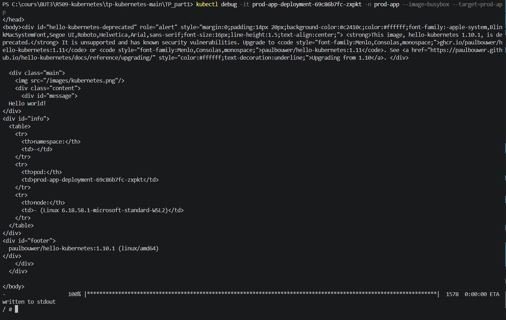

# Réponses - Partie 5

## Partie 1 : Déploiement

### Déploiement initial

Les ressources sont déployées dans le namespace `prod-app` avec les commandes
suivantes :

```powershell
kubectl apply -f prod-app\my_namespace.yml
kubectl apply -n prod-app -f prod-app\app-deployment.yml
kubectl apply -n prod-app -f prod-app\app-service.yml
kubectl port-forward -n prod-app svc/prod-app-service 8080:8080
```

### Question 1

La valeur **Pod Name** change lors des rafraîchissements. Le Service
`ClusterIP` répartit les requêtes entre les trois Pods du Deployment. Chaque Pod
possède un nom différent, ce qui explique que le nom affiché puisse changer.



### Question 2

Avec les valeurs suivantes :

```yaml
requests:
  cpu: "100m"
  memory: "64Mi"
limits:
  cpu: "200m"
  memory: "128Mi"
```

le Pod appartient à la classe de qualité de service **Burstable**. Cette classe
est utilisée lorsqu'au moins une request ou une limit est définie, mais que les
requests et les limits ne sont pas identiques pour toutes les ressources.

La classe `Burstable` est importante en production car elle garantit un minimum
de ressources au Pod tout en lui permettant d'utiliser davantage de ressources
si le nœud en possède. Cela évite qu'une application soit complètement
privée de ressources et aide Kubernetes à choisir les Pods à évincer en cas de
pression sur le nœud.

Pour vérifier la classe QoS :

```powershell
kubectl describe pod <nom-du-pod> -n prod-app
```



## Partie 2 : Probes

### Question 3

Si le processus est bloqué par un deadlock, le conteneur peut rester démarré
sans répondre correctement. La `livenessProbe` détecte les échecs de réponse.
Après plusieurs échecs, Kubernetes redémarre automatiquement le conteneur afin
de rétablir son fonctionnement.

### Question 4

Une erreur de `livenessProbe` entraîne le redémarrage du conteneur. Une erreur
de `readinessProbe` ne redémarre pas le conteneur : le Pod est simplement
retiré des endpoints du Service et ne reçoit plus de trafic.

Le composant qui cesse d'envoyer le trafic est le **Service Kubernetes**, via
la gestion de ses endpoints par le contrôleur EndpointSlice.

La commande utilisée pour observer les événements est :

```powershell
kubectl describe pod <nom-du-pod> -n prod-app
```

> Dans l'environnement utilisé, l'image `hello-kubernetes:1.10` répond sur `/`
> mais renvoie `404` pour `/healthz` et `/ready`. Les sondes du fichier YAML
> utilisent donc `/` pour obtenir un résultat fonctionnel.

## Partie 3 : Déploiements sans interruption

### Question 5

Les `readinessProbes` empêchent Kubernetes d'envoyer du trafic à un nouveau Pod
tant que celui-ci n'est pas prêt. Pendant un `RollingUpdate`, Kubernetes crée
donc un nouveau Pod, attend qu'il soit prêt, puis supprime progressivement un
ancien Pod. Cette méthode permet de conserver des Pods disponibles et d'éviter
les interruptions de service.

Pour observer le remplacement :

```powershell
kubectl get pods -n prod-app -w
```



### Question 6

Le `preStop` hook donne du temps au conteneur avant son arrêt définitif. Il
permet notamment de terminer les requêtes en cours et de se retirer
proprement du trafic.

Dans une vraie application, ce délai pourrait être utilisé pour :

- terminer les traitements en cours ;
- fermer les connexions à la base de données ;
- arrêter la réception de nouvelles requêtes ;
- vider les files de messages ;
- enregistrer proprement l'état de l'application.

## Partie 4 : Débogage

### Question 7

Un conteneur de débogage éphémère permet d'ajouter temporairement des outils
comme `wget`, `curl` ou `ping` sans modifier l'image de production.

Cette approche est préférable car elle :

- garde l'image de production légère ;
- réduit la surface d'attaque ;
- évite d'installer des outils inutiles dans l'application ;
- limite les risques liés aux vulnérabilités de ces outils ;
- permet de supprimer le conteneur de débogage après utilisation.

Commandes utilisées :

```powershell
kubectl debug -it <nom-du-pod> -n prod-app --image=busybox --target=prod-app
wget -O - localhost:8080
```


